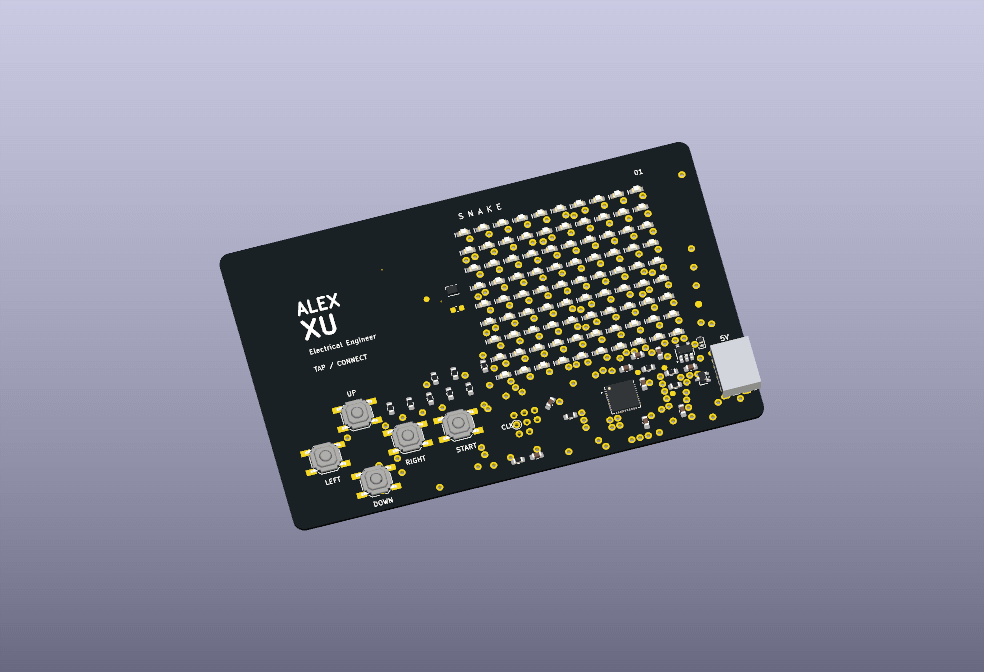
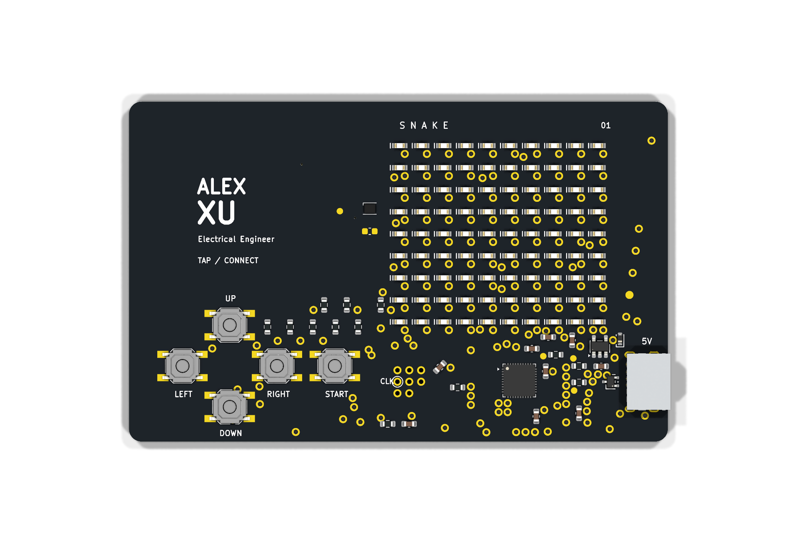
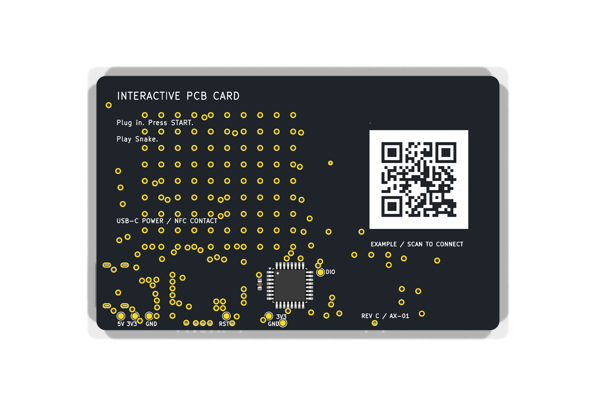

# Snake PCB Business Card

A USB-powered PCB business card with a 10 × 9 LED matrix, five buttons and Snake firmware. A passive NFC tag and a silkscreen QR code carry the contact URL.

[](https://github.com/alex1324575/snake-pcb-business-card/actions/workflows/firmware.yml)



| Rev C — Top | Rev C — Bottom |
|---|---|
|  |  |

3D assembly previews use the current Rev C layout and all 125 fitted parts. The animation shows the assembly from both sides with the LEDs unlit. A [static isometric view](docs/images/revc-3d-isometric.png) and [model provenance](docs/revc/3D_VISUALIZATION.md) are also available. Public artwork uses **ALEX XU** and **https://example.com/**.

## Current revision

**Rev C is the current Altium prototype design.** CAD corrections, native validation and final CAM review are complete. Supplier process acceptance and first-article qualification remain open; all 14 physical tests are **NOT TESTED**.

| Check | Recorded result — 28 October 2026 |
|---|---|
| Native PCB DRC | 0 violations, 0 warnings, 0 waivers; all 43 stored rule records unchanged |
| Native schematic validation | 0 errors, 2 reviewed reset-bias warnings, retained without suppression |
| Saved-source audit | 135 schematic instances, 29 symbols, 15 footprints; 217 firmware contract checks passed |
| Manufacturing output review | Nine Gerbers and two plated-hole/slot NC files matched to the final saved PCB |
| Hardware qualification | P01–P14 NOT TESTED; no assembled-board result recorded |

The [verification guide](docs/VERIFICATION.md) identifies the reports, public-copy transformations and test limits. Layout compromises, including retained orthogonal NFC coil corners, are listed in [layout tradeoffs](docs/revc/LAYOUT_TRADEOFFS.md).

## Hardware

| Feature | Rev C implementation |
|---|---|
| Board | 85.6 × 54 mm, two layers, nominal 0.8 mm, four R2 corners |
| Finish | Black solder mask, white silkscreen, ENIG |
| MCU | STM32G030K8T6, Cortex-M0+, 64 KB Flash / 8 KB SRAM |
| Display | 90 red LEDs and IS31FL3737B PWM driver |
| Input | Four direction buttons and START |
| Power | USB-C 5 V, TPS7A2433DBVR 3.3 V regulator; no battery |
| Contact | Bottom QR artwork and ST25TN01K passive NFC tag |
| Programming | SWD test pads on both faces; TP7/SWCLK is on Top |

USB-C supplies power only. Firmware is programmed over SWD. NFC operates independently of USB power and is provisioned separately from the MCU.

## Open the design

Open [SnakeCard_RevC.PrjPcb](altium/SnakeCard_RevC.PrjPcb) in Altium Designer. The project contains the single-sheet schematic, routed PCB and local schematic/footprint libraries. The [Altium guide](docs/ALTIUM.md) describes the files and validation procedure.

| Purpose | Current Rev C files |
|---|---|
| Review the circuit | [Native schematic PDF](exports/SnakeCard_RevC_Schematic.pdf) and [hardware notes](docs/HARDWARE.md) |
| Review checks | [Verification](docs/VERIFICATION.md) and [final status record](verification/revc/FINAL_CHECK_STATUS.json) |
| Select parts | [Controlled BOM — SC-REVC-LCSC-P1](docs/revc/assembly/BOM.md) |
| Fabricate | [Gerber/NC files](fabrication/revc/) and [fabrication specification](docs/revc/FABRICATION_NOTES.md) |
| Assemble | [Assembly guide](docs/ASSEMBLY.md), [placement register](docs/revc/assembly/PLACEMENT_REGISTER.md) and [drawings](docs/revc/assembly/ASSEMBLY_REFERENCE.html) |
| Test the first board | [Bring-up](docs/BRINGUP.md) and [P01–P14 qualification record](docs/revc/electrical/QUALIFICATION_PLAN.md) |

The root KiCad project and earlier exports remain as the **historical KiCad revision**. They were not updated to Rev C. Do not combine their BOM, footprint, stencil, SWD or fabrication data with Rev C. See [revision history](docs/REVISION_HISTORY.md).

## Firmware

The C11 firmware uses register-level board support, with no heap or RTOS. It implements Snake, button debounce, PWM display control and fault recovery. Rev C retains the tested firmware source and release images; the original `RevB` binary filenames are retained. The native Rev C pin contract was checked separately. MCU execution remains untested.

From the repository root, with Python 3.9+ and an Arm GNU toolchain installed:

```sh
python firmware/tools/build.py --build
```

Host tests also require GCC, Clang or Microsoft C++ Build Tools:

```sh
python firmware/tools/build.py --test-host --sanitize
```

The [firmware guide](firmware/README.md) covers toolchains, checksums and controls. `firmware/tools/check_board_contract.py` checks the historical KiCad inputs; it does not replace the saved-native Rev C audit.

### Controls

- Press START to begin, pause or resume.
- Use the direction buttons to steer toward the flashing food pixel.
- Hold START for about 0.8 seconds to return to idle.
- Hold UP while idle to view the highest score from the current power session.
- Hold START during power-up to enter the LED/button diagnostic; release it and press START again to exit.

Assemble and measure one controlled first article before building additional cards. Use the [prototype plan](docs/PROTOTYPE_PLAN.md) to track supplier, assembly and qualification gates. Contribution and license information are in [CONTRIBUTING](CONTRIBUTING.md) and [THIRD_PARTY_NOTICES](THIRD_PARTY_NOTICES.md).
