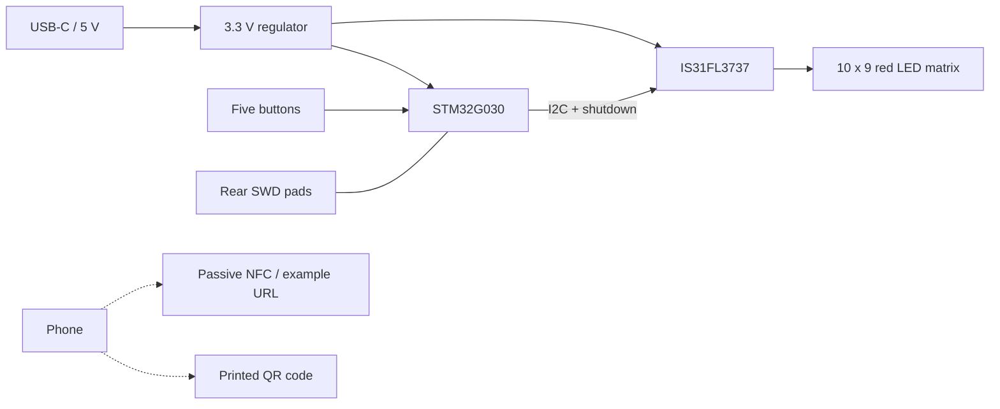

# Snake PCB Business Card

A playable business card built around a 10 × 9 LED matrix, an STM32 microcontroller, and a single game of Snake.

[](https://github.com/alex1324575/snake-pcb-business-card/actions/workflows/firmware.yml)


**USB-C power. Five buttons. Ninety LEDs. A business card you can actually play.**

The front combines a compact game interface with a clean nameplate. The back carries a QR code, a passive NFC antenna, and programming pads. The design uses black solder mask, white silkscreen, and an ENIG finish on a 0.8 mm board.

All example artwork uses **Alex Parker**, a fictional identity. The example QR code and NFC payload both point to **https://example.com/**.

> **Prototype status:** the design has passed digital checks, and the firmware has been built and tested on a host computer. An assembled board has not yet been powered or validated. The images are KiCad renders; see the [verification record](docs/VERIFICATION.md) for the exact scope.

## At a glance

| | |
|---|---|
| Board | 85.6 × 54 mm, rounded corners, two layers, 0.8 mm thick |
| MCU | STM32G030K8T6, Cortex-M0+, 64 KB Flash / 8 KB SRAM |
| Display | 10 × 9 discrete red LEDs, IS31FL3737 PWM driver |
| Controls | Four direction buttons and START |
| Power | USB-C 5 V input, 3.3 V regulation; no battery |
| Contact | Printed QR code and independent ST25TN01K passive NFC |
| Firmware | C11, register-level board support, no heap or RTOS |
| Programming | SWD through five pads on the back |

## The board

| Front | Back |
|---|---|
|  |  |

The native KiCad project, six-sheet schematic, custom libraries, manufacturing exports, firmware, and verification reports are included. The USB-C connector supplies power only; it is not a USB data or firmware-update interface.

## Play

1. Connect USB-C power. The board shows an **AP** startup mark, then the idle animation.
2. Press and release **START** to begin.
3. Use the direction buttons to steer. Eat the flashing pixel; avoid walls and your own body.
4. Press **START** to pause or resume. Hold it for about 0.8 seconds to return to idle.

The snake speeds up as it grows. Filling all 90 cells wins the game at 87 points. The final score appears as two digits. Hold **UP** while idle to see the highest score from the current power session.

For assembly checks, hold **START** while applying power to enter the LED/button diagnostic. Release it, then press START again to exit.

## Architecture



The NFC tag is independent of the game electronics. It does not need USB power and is not programmed by the MCU in this design.

## Get started

### Open the hardware

Open [`SnakeBusinessCard.kicad_pro`](SnakeBusinessCard.kicad_pro) in **KiCad 10** with the standard KiCad libraries installed. Project-specific symbols and footprints resolve through `${KIPRJMOD}`.

- [Schematic PDF](exports/SnakeBusinessCard_Schematic.pdf)
- [Bill of materials](exports/SnakeBusinessCard_BOM.csv)
- [Hardware design notes](docs/HARDWARE.md)
- [Fabrication and assembly](docs/ASSEMBLY.md)

### Build and test the firmware

Install Python 3.9+ and an Arm GNU `arm-none-eabi-gcc` toolchain, then run:

```sh
cd firmware
python tools/build.py --build
```

For host tests, also install a native GCC/Clang compiler or Microsoft C++ Build Tools:

```sh
python tools/build.py --test-host --sanitize
python tools/check_board_contract.py
```

The build emits HEX, BIN, ELF, a linker map, and a manifest under `firmware/release/`. Set `ARM_GCC_BIN` or pass `--gcc-bin` if the cross-compiler is not on PATH. See the [firmware guide](firmware/README.md) for toolchain versions, controls, architecture, and test details.

### Program a sample

Use a 3.3 V-compatible ST-LINK and power the board through USB-C. Connect SWDIO, SWCLK, NRST, GND, and the target-voltage sense input. The pads are **1.0 mm in diameter on 3.0 mm centers**, not a standard 2.54 mm header.

Follow the [first-board guide](docs/BRINGUP.md) for the correct back-view pad order, programming commands, and initial checks.

## Make it yours

Use the public example as a starting point for your nameplate, contact URL, and visual treatment. Regenerate both the QR artwork and NFC payload when changing the URL.

- [Personalization workflow](docs/CUSTOMIZATION.md)
- [QR and NFC data](docs/CONTACT.md)

## Repository layout

```text
*.kicad_*          Native KiCad project, schematic, and routed PCB
library/           Project symbols, footprints, and envelope models
firmware/          C source, host tests, build tools, and firmware images
contact/           Example QR and NFC assets
exports/           Schematic PDF, BOM, and exported netlist
fabrication/       Gerber and drill exports
verification/      Hardware check results
docs/              Design, assembly, bring-up, and customization guides
tools/             Contact asset and hardware export tools
```

## Verification and next steps

Host tests exercise movement, growth, collision handling, timing rollover, button debounce, pause/restart behavior, full-board victory, display mapping, and injected I²C failures. The board-contract check compares the firmware with the actual netlist and all 90 LED positions.

The next engineering milestone is sample-board validation: display brightness and current, I²C waveforms, thermal behavior, repeated power cycles, fault recovery, and NFC tuning. Passive component ordering codes and assembly details also require final review before manufacturing.

See [verification](docs/VERIFICATION.md) and [third-party notices](THIRD_PARTY_NOTICES.md). Contributions should include a focused change description and the checks relevant to that change; the [contribution guide](CONTRIBUTING.md) explains the workflow.
