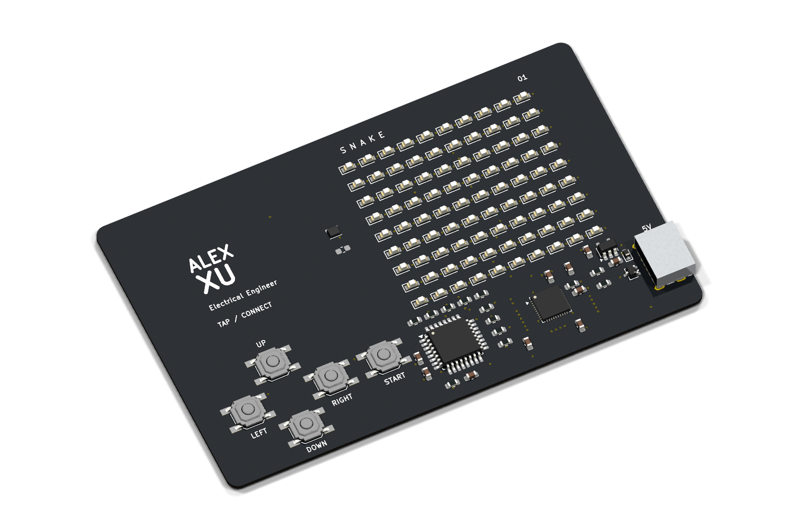
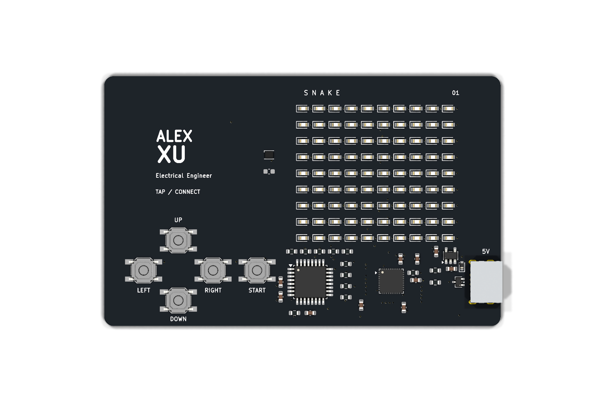
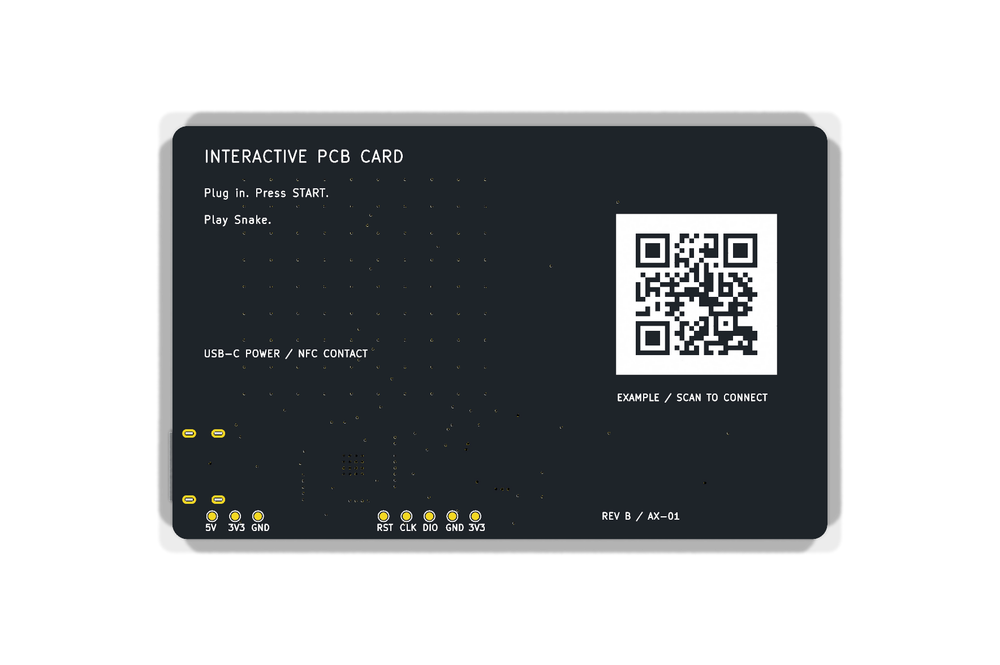
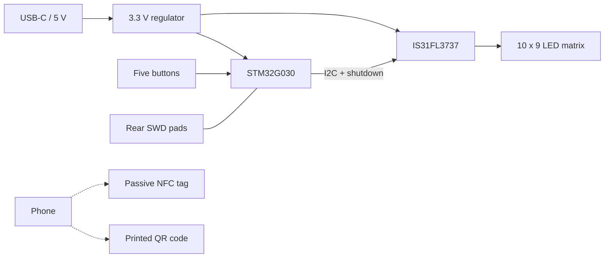

# Snake PCB Business Card

A USB-powered PCB business card with a 10 × 9 LED matrix, five buttons, and Snake firmware. A separate passive NFC tag and a printed QR code carry the contact URL.

[](https://github.com/alex1324575/snake-pcb-business-card/actions/workflows/firmware.yml)




**Status:** five bare boards have been ordered. Assembly and first-board bring-up are pending. Firmware host tests and the Arm build run in CI; hardware check results are listed in [Verification](docs/VERIFICATION.md).

The images are KiCad renders. Public artwork uses **Alex Xu** and the URL **https://example.com/**.

## Hardware

| Feature | Implementation |
|---|---|
| Board | 85.6 × 54 mm, two layers, 0.8 mm thick, R2 corners |
| Finish | Black solder mask, white silkscreen, ENIG |
| MCU | STM32G030K8T6, Cortex-M0+, 64 KB Flash / 8 KB SRAM |
| Display | 90 discrete red LEDs, IS31FL3737 PWM driver |
| Input | Four direction buttons and START |
| Power | USB-C 5 V input, 3.3 V regulation; no battery |
| Contact | Rear QR code and ST25TN01K passive NFC tag |
| Programming | Rear SWD pads |

| Front | Back |
|---|---|
|  |  |



USB-C supplies power only. Firmware is programmed over SWD. The NFC tag operates without USB power and must be provisioned separately from the MCU.

## Design files

The repository contains two layout revisions. Use the outputs associated with the revision you are building.

| Project | Contents | Manufacturing outputs |
|---|---|---|
| [KiCad 10](SnakeBusinessCard.kicad_pro) | Six-sheet schematic, routed PCB, custom libraries | Included in [`exports/`](exports/) and [`fabrication/`](fabrication/) |
| [Altium Designer](altium/SnakeCard_Native.PrjPcb) | Single-sheet schematic, routed PCB, 29-symbol SchLib and 15-model PcbLib | Regenerate from Altium; this layout has later via and paste changes |

KiCad project libraries resolve through `${KIPRJMOD}`. The [Altium notes](docs/ALTIUM.md) describe its layout changes and local libraries.

- [Schematic PDF](exports/SnakeBusinessCard_Schematic.pdf)
- [Procurement BOM](exports/Procurement_BOM.csv)
- [Hardware design notes](docs/HARDWARE.md)
- [Component review and open issues](docs/COMPONENT_REVIEW.md)
- [Fabrication and assembly](docs/ASSEMBLY.md)

## Firmware

The firmware uses C11 and register-level board support, with no heap or RTOS. It implements game logic, button debounce, PWM display control, and fault recovery.

From the repository root, with Python 3.9+ and an Arm GNU toolchain installed:

```sh
python firmware/tools/build.py --build
```

Host tests also require GCC, Clang, or Microsoft C++ Build Tools:

```sh
python firmware/tools/build.py --test-host --sanitize
python firmware/tools/check_board_contract.py
```

Outputs are written to [`firmware/release/`](firmware/release/). Set `ARM_GCC_BIN` or use `--gcc-bin` if the cross-compiler is not on PATH. Toolchain and sanitizer support are documented in the [firmware guide](firmware/README.md).

### Controls

- Press START to begin, pause, or resume.
- Use the direction buttons to steer toward the flashing food pixel.
- Hold START for about 0.8 seconds to return to idle.
- Hold UP while idle to view the highest score from the current power session.
- Hold START during power-up to enter the LED/button diagnostic; release it and press START again to exit.

The snake accelerates as it grows. Filling all 90 cells ends the game at 87 points. Scores use two-digit LED glyphs.

### Programming and bring-up

Use a 3.3 V-compatible ST-LINK and USB-C power. Connect SWDIO, SWCLK, NRST, GND, and target-voltage sense. The rear pads are 1.0 mm in diameter on 3.0 mm centers.

The [bring-up guide](docs/BRINGUP.md) gives the back-view pad order, programming commands, and first-board measurements. Assemble and test one card before populating the remaining boards. Capacitor selection, switch-area vias, QFN assembly, input protection, and NFC tuning still have open review items.

## Contact details and documentation

Use [Customization](docs/CUSTOMIZATION.md) to change the nameplate, startup initials, QR artwork, and NFC payload. The [contact guide](docs/CONTACT.md) covers tag provisioning.

See [Verification](docs/VERIFICATION.md) for results and test scope, and the [prototype plan](docs/PROTOTYPE_PLAN.md) for the next build. Contribution instructions and licensing information are in [CONTRIBUTING](CONTRIBUTING.md) and [THIRD_PARTY_NOTICES](THIRD_PARTY_NOTICES.md).
