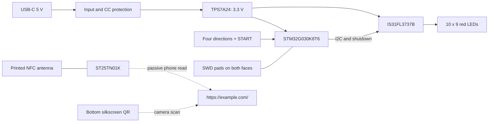

# Rev C hardware

The current design is a USB-powered game with an independent passive NFC contact tag. Native CAD and final CAM checks are complete; no assembled board has been tested. See [Verification](VERIFICATION.md) for scope.

Open [SnakeCard_RevC.PrjPcb](../altium/SnakeCard_RevC.PrjPcb) in Altium Designer, or review the [single-sheet schematic PDF](../exports/SnakeCard_RevC_Schematic.pdf). The root KiCad design is a historical revision and has not been synchronized to Rev C.

## Architecture

USB-C supplies power only; it has no USB data connection or firmware-upload path. There is no battery. The NFC tag operates independently of the MCU and USB supply; the circuit provides no MCU interface for writing the tag.

## Selected implementation

| Item | Rev C design |
|---|---|
| Profile | 85.6 × 54 mm, four 2 mm-radius corners |
| PCB | FR-4, two copper layers, nominal 0.8 mm finished target |
| Finish | Black solder mask, white silkscreen, ENIG |
| Controller | STM32G030K8T6, LQFP32, internal 16 MHz clock |
| Driver | Lumissil IS31FL3737B-QFLS4-TR, QFN40 with grounded exposed pad |
| LEDs | 90 KENTO KT-0603R, 3.5 mm pitch |
| Input | Five Alps Alpine SKQGABE010 switches |
| Regulator | Texas Instruments TPS7A2433DBVR, fixed 3.3 V |
| VBUS protection | Nexperia PESD5Z6.0,115; K1 to VBUS_5V, A2 to GND |
| CC protection | Texas Instruments TPD2E2U06QDCKRQ1 |
| NFC | ST25TN01K-AFH5 and printed antenna; C30 initially DNP |
| Public identity | ALEX XU / Electrical Engineer; example.com |

Exact selections and supplier identifiers are controlled by [SC-REVC-LCSC-P1](revc/assembly/BOM.md). Some legacy symbol/footprint names identify retained geometry, not the selected purchasing part. The 0.8 mm target does not include component height. Finished thickness tolerance and USB fit require supplier and first-article acceptance.

## MCU connections

| Function | U1 physical pin | GPIO | Exact net |
|---|---:|---|---|
| Up | 7 | PA0 | BTN_UP |
| Down | 8 | PA1 | BTN_DOWN |
| Left | 9 | PA2 | BTN_LEFT |
| Right | 10 | PA3 | BTN_RIGHT |
| Start | 11 | PA4 | BTN_START |
| Display enable | 12 | PA5 | LED_EN |
| I²C clock | 30 | PB6, AF6 | I2C_SCL |
| I²C data | 31 | PB7, AF6 | I2C_SDA |
| SWD data | 24 | PA13 | SWDIO |
| SWD clock | 25 | PA14 | SWCLK |
| Reset | 6 | NRST | NRST |

Buttons switch to GND and have external 10 kΩ pull-ups. I²C uses 2.2 kΩ pull-ups to +3V3. LED_EN has a 100 kΩ pull-down so the display starts disabled. R23 holds active-high LED_IICRST low through 10 kΩ; R10 holds MCU NRST high through 10 kΩ, with C12 filtering.

Rev C SWD contacts are on both faces: **TP7/SWCLK is Top**; TP6/SWDIO, TP8/NRST, TP4/+3V3 sense and TP5/GND are Bottom. The [bring-up table](BRINGUP.md#2-connect-swd-on-both-faces) replaces the earlier rear-row diagram.

## Display mapping and current limit

Front-view coordinates start at the upper-left LED: `D(1 + x + 10*y)`, where `x=0..9` and `y=0..8`. D1/D10/D81/D90 are the corners. PCB pad 2 is the anode on LED_COL1..10 / CS1..CS10; pad 1 is the cathode on LED_ROW1..9 / SW1..SW9. **KENTO physical cathode faces left in Top view; supplier pin numbering is reversed relative to the PCB.**

The driver uses seven-bit I²C address `0x50`. R24 is 20 kΩ and firmware limits global current to **GCC ≤32**. Nominal active-channel current is 5.25 mA. With all 90 pixels at PWM255/256 and the documented scan duty, calculated average LED current is **36.91 mA**; tolerances and MCU/driver overhead are additional. This is a calculation, not a measurement. [IS31FL3737B datasheet](https://www.lumissil.com/assets/pdf/core/IS31FL3737B_DS.pdf).

The frozen large-via rule leaves no via drill within U2's exposed pad. Heat flow and the bulk-capacitor path require the specified load-step and thermal tests. Keep the project prototype envelope at 4.75–5.25 V input, 10–40 °C ambient and the 100 mA input-current screen until measured evidence supports a change.

## Power protection and qualification

The U3/D91 ECO corrects the known positive clamp-versus-regulator rating mismatch in CAD. It does not qualify system ESD, negative stress or layout overshoot. TPS7A24 provides no reverse-current blocking; disable SWD target-power output and do not externally energize +3V3 without VBUS. C1/C2 require effective capacitance ≥0.50 µF with combined derating and uncertainty accounted for.

See the [power ECO](revc/electrical/POWER_ECO_RECOMMENDATION.md) and [qualification plan](revc/electrical/QUALIFICATION_PLAN.md) for the exact acceptance boundaries. Startup, load response, positive/negative transients, reverse bias and thermal behavior are all NOT TESTED.

## NFC and layout boundary

Unrelated copper is excluded from the antenna/feed area. QR artwork is silkscreen only. C30 stays DNP until measured tuning supports a selected value. The coil retains orthogonal corners as an explicit appearance exception; tuning and phone trials remain open. See [layout tradeoffs](revc/LAYOUT_TRADEOFFS.md) and P12 in the [qualification record](revc/electrical/QUALIFICATION_PLAN.md).
