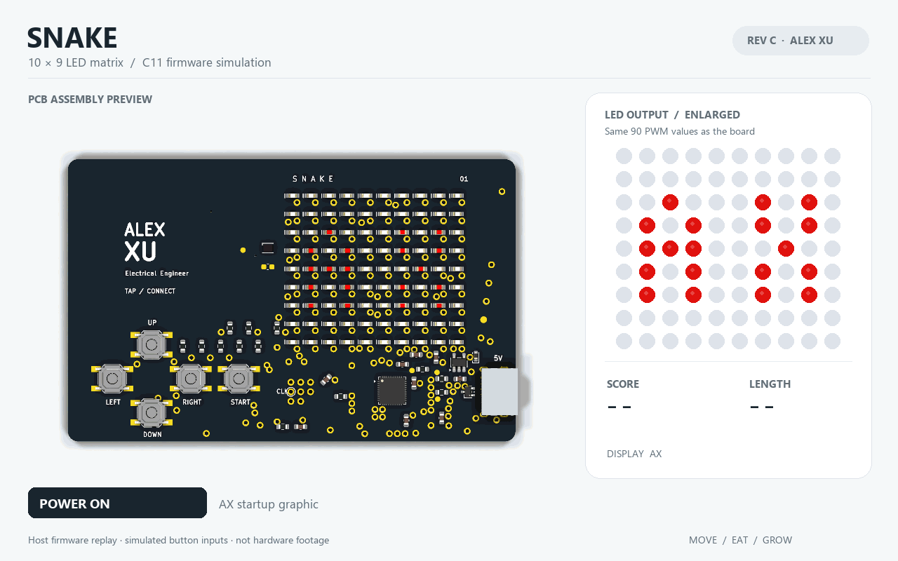

# Snake gameplay demo



The 15.04-second loop shows the production C game logic running on a host
computer. The populated Rev C board and enlarged 10 × 9 display use the same
90 PWM values returned by `app_render`, in front-view row-major order. The
enlarged display makes the individual moves visible without changing the game.

## Captured sequence

| Item | Recorded result |
|---|---|
| Seed | 25 |
| Input | START followed by eight direction turns |
| Food | Four pickups generated and scored by the firmware |
| Snake length | 3 → 7 cells |
| Game over | Wall collision at 12.750 seconds |
| Result | Firmware's 900 ms flash, followed by score `04` |
| Capture | 188 samples at 80 ms intervals; 79 distinct PWM frames |
| GIF | 1280 × 800 pixels; 84 encoded frames; continuous loop |

The opening AX glyph, READY animation, flashing food, movement speed, collision
and score glyphs all come from the unchanged firmware. Identical consecutive
images are combined when encoding the GIF; their display duration is retained.

## Firmware and rendering

The [host recorder](../../tools/demo/record_gameplay.c) links the repository's
unchanged [`app.c`](../../firmware/src/app.c),
[`buttons.c`](../../firmware/src/buttons.c) and
[`snake.c`](../../firmware/src/snake.c). It calls `app_update` every simulated
millisecond and captures `app_render` every 80 ms.

A breadth-first controller acts as an external test player. It observes the
current snake and food, then sends 40 ms raw direction-button presses through
the firmware's 20 ms debounce logic. It never assigns game cells, food, score or
application state. This controller is part of the host recorder, not the
embedded firmware. After four pickups, it keeps the current direction until the
snake reaches a wall.

The board uses the [Rev C assembly geometry and package models](3D_VISUALIZATION.md).
Red lens emission illustrates the captured PWM values. Apparent LED
brightness is approximate, with a square-root display mapping; it is not a
photometric prediction. Generic package bodies do not establish exact
manufacturer geometry or assembly fit.

This demonstrates the software state machine and display output. MCU execution,
electrical timing, LED brightness and physical-board operation remain untested.
The [hardware qualification record](electrical/QUALIFICATION_PLAN.md) remains
the authority for those checks.

## Reproduce the gameplay capture

From the repository root, with GCC and Python installed:

```sh
mkdir -p build/gameplay-demo
gcc -std=c11 -O2 -Wall -Wextra -I firmware/include \
  tools/demo/record_gameplay.c \
  firmware/src/app.c firmware/src/snake.c firmware/src/buttons.c \
  -o build/gameplay-demo/record_gameplay
./build/gameplay-demo/record_gameplay 25 \
  > build/gameplay-demo/trace.jsonl \
  2> build/gameplay-demo/summary.json
python tools/check_gameplay_trace.py --capture build/gameplay-demo/trace.jsonl
```

These commands reproduce and check the firmware capture. The published GIF's
dimensions, timing, source hashes and rendering checks are recorded separately.

## Evidence

- [Capture and rendering record](../../verification/revc/GAMEPLAY_DEMO.json)
- [Published PWM trace and firmware source hashes](../../verification/revc/GAMEPLAY_TRACE.json)
- [Host recorder source](../../tools/demo/record_gameplay.c)
- [Trace checker](../../tools/check_gameplay_trace.py)

The [assembly rotation preview](../images/revc-3d-rotation.gif) is a separate
geometry presentation with unlit LEDs.
